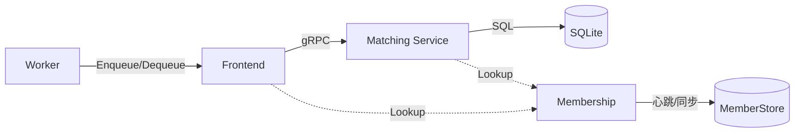
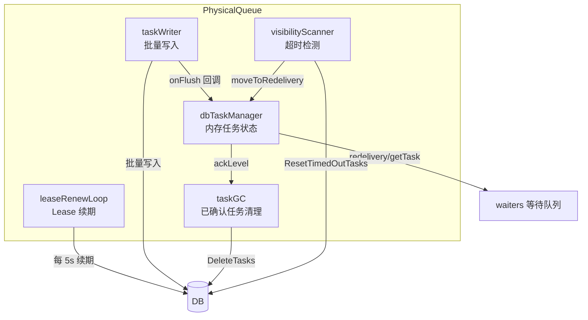
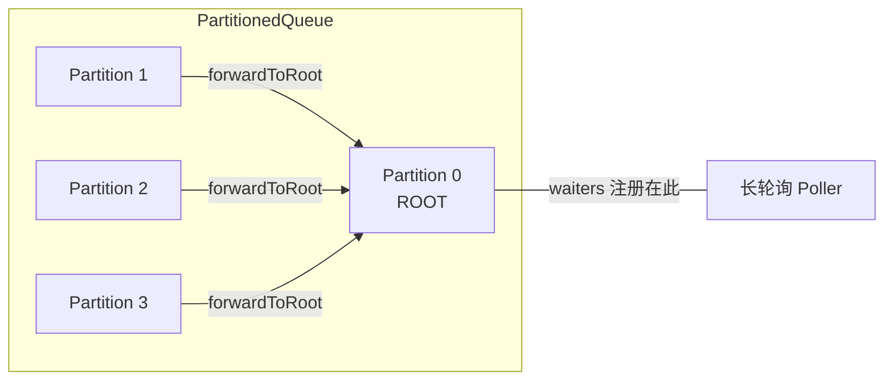
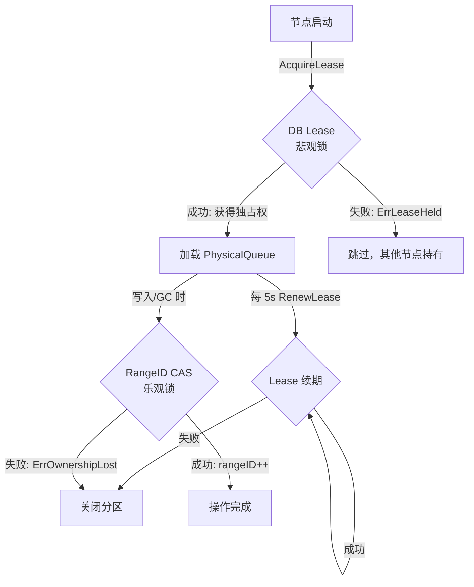
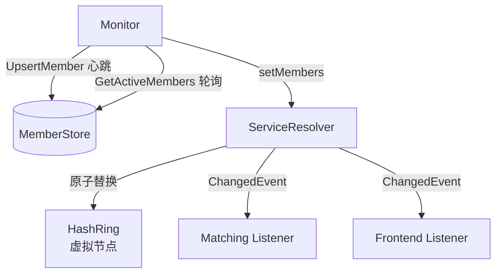
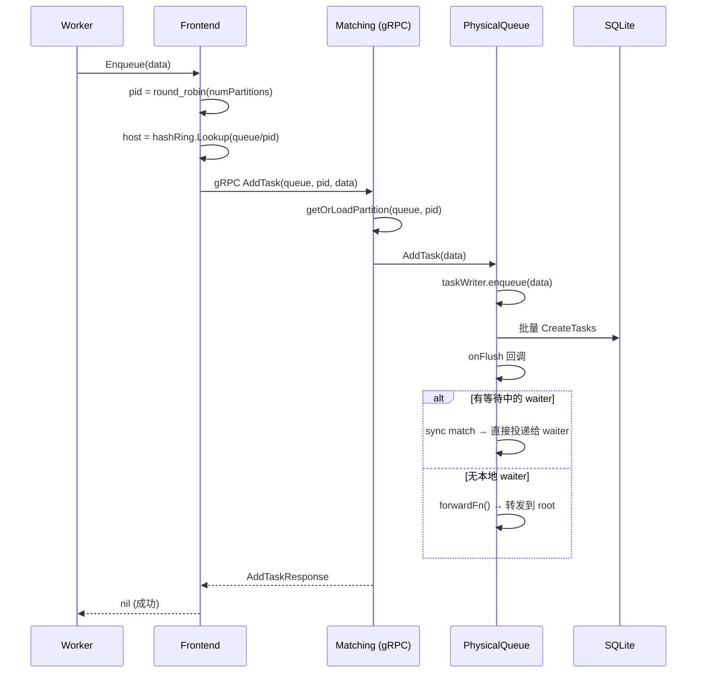
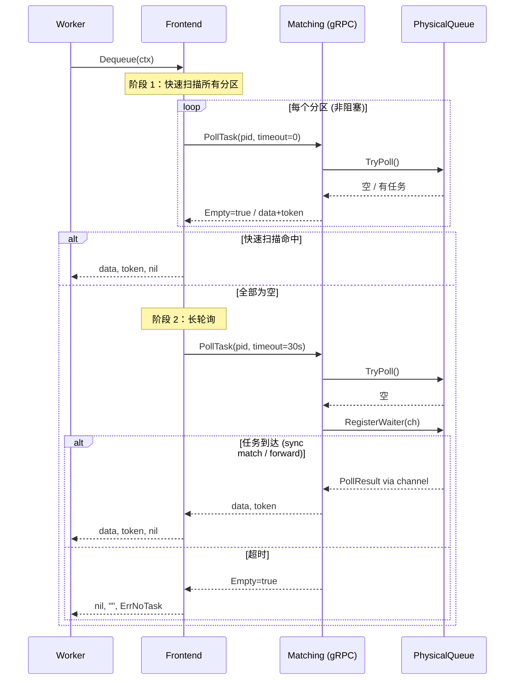
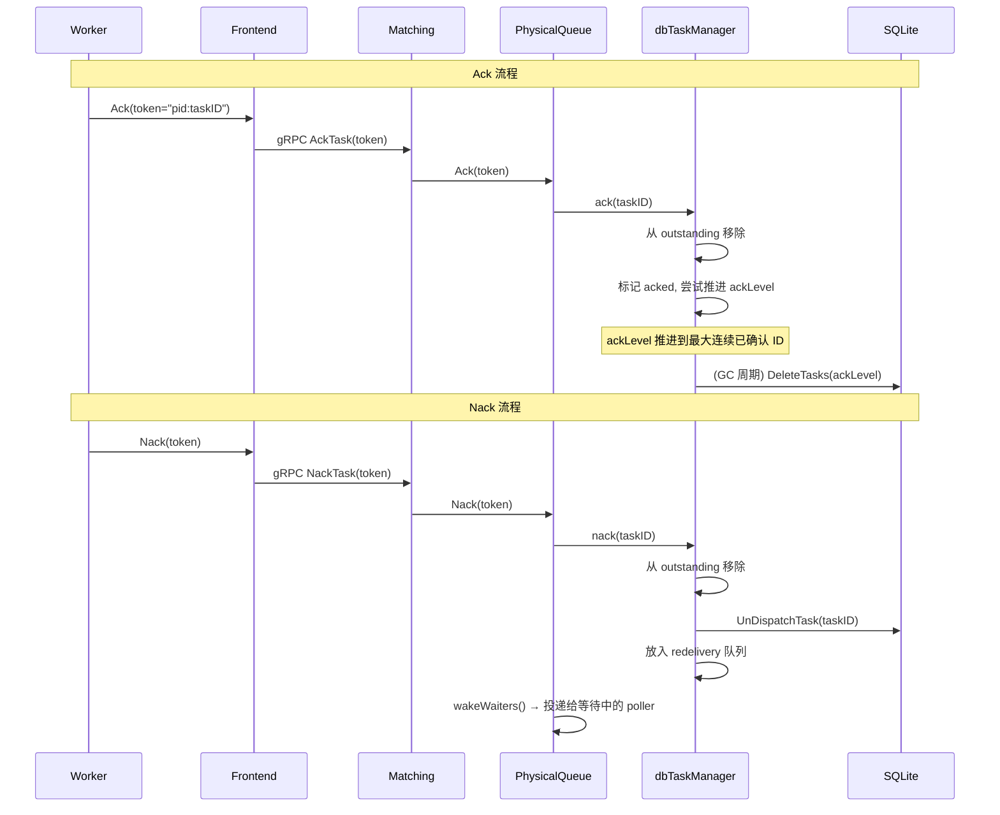
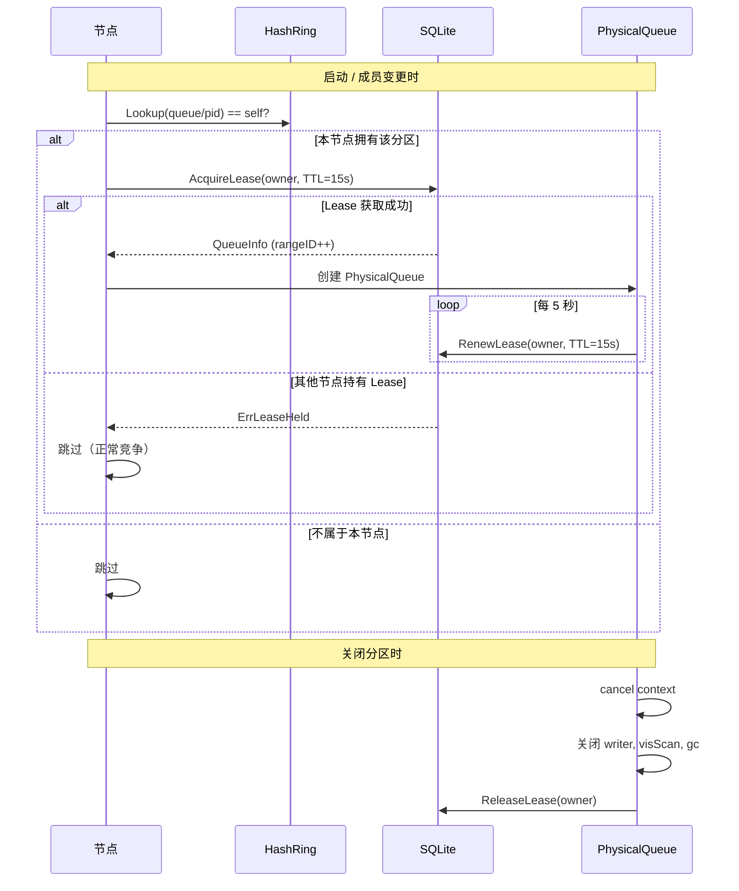
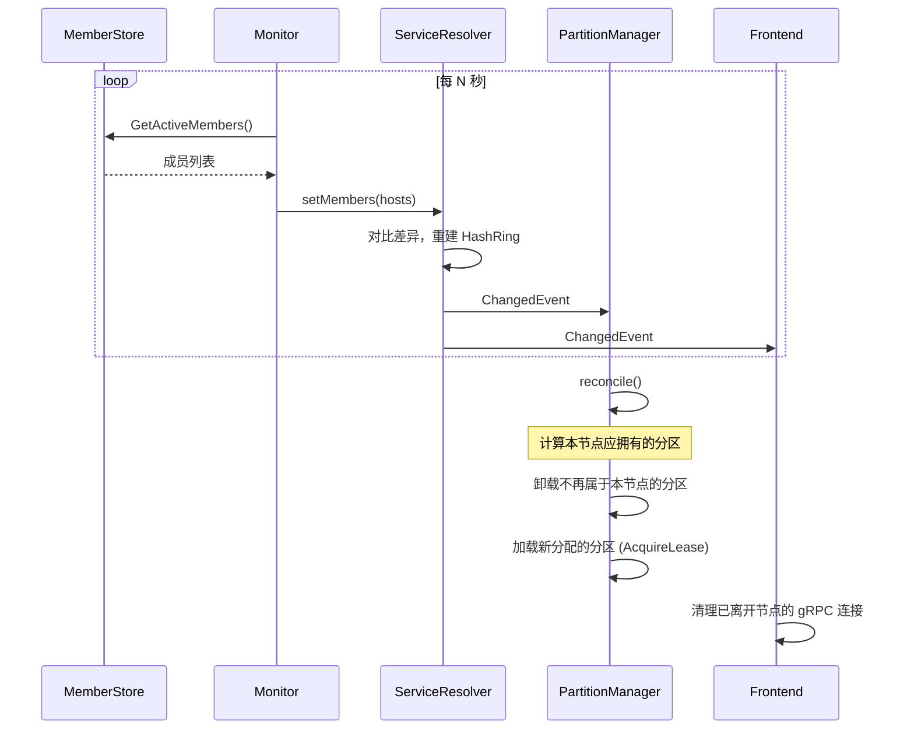

# TaskQ — 分布式任务队列

TaskQ 是一个 Temporal 风格的分布式任务队列系统，使用 Go 实现。支持多分区、at-least-once 投递语义、一致性哈希路由、DB lease 分区独占、长轮询消费和可见性超时自动重投递。

## 核心特性

- **多分区队列** — 水平扩展吞吐量，round-robin 分发写入
- **At-least-once 投递** — 可见性超时 + 自动重投递，确保任务不丢失
- **一致性哈希路由** — 基于虚拟节点的哈希环，分区自动分配到集群节点
- **DB Lease + RangeID CAS** — 双层所有权保护，悲观锁 + 乐观锁防止脑裂
- **长轮询消费** — 无任务时 worker 阻塞等待，任务到达即时唤醒
- **Sync Match** — 写入时直接匹配等待中的消费者，零延迟投递
- **分区转发模型** — 非 root 分区转发到 root，统一协调长轮询

## 系统架构

```
┌──────────┐     ┌──────────────┐     gRPC      ┌─────────────────┐     SQL     ┌────────┐
│  Worker  │────▶│   Frontend   │──────────────▶│    Matching      │───────────▶│   DB   │
│  (消费者) │◀────│  (路由层/库)  │◀──────────────│  (分区管理/gRPC) │◀───────────│(SQLite)│
└──────────┘     └──────────────┘               └─────────────────┘            └────────┘
                        │                              │
                        │        ┌──────────────┐      │
                        └───────▶│  Membership  │◀─────┘
                                 │ (成员发现/哈希环)│
                                 └──────────────┘
```



### 四层架构

| 层 | 包 | 职责 |
|---|---|---|
| **Worker** | 用户代码 | 调用 Frontend API 生产/消费任务 |
| **Frontend** | `frontend` | 客户端路由库，一致性哈希定位分区所属节点，gRPC 连接池 |
| **Matching** | `matching` | gRPC 服务，管理分区所有权，处理 AddTask/PollTask/Ack/Nack |
| **Queue** | `queue` | 核心存储引擎，PhysicalQueue 管理单分区的完整生命周期 |
| **Membership** | `membership` | 节点发现，一致性哈希环，成员变更通知 |

## 核心组件

### Queue 包

#### Store 接口

`Store` 是可插拔的持久化抽象层，当前提供 SQLite（WAL 模式）实现。

```go
type Store interface {
    // 队列元数据
    CreateQueue(ctx, info) error
    GetQueue(ctx, queueName, partitionID) (*QueueInfo, error)
    UpdateQueue(ctx, info, prevRangeID) error        // rangeID CAS

    // 任务 CRUD
    CreateTasks(ctx, tasks) error
    GetTasks(ctx, queueName, partitionID, min, max, limit) ([]*TaskRow, error)
    DispatchTask(ctx, queueName, partitionID, taskID, dispatchedAt) error
    UnDispatchTask(ctx, queueName, partitionID, taskID) error
    ResetTimedOutTasks(ctx, queueName, partitionID, ackLevel, visTimeout) ([]int64, error)
    DeleteTasks(ctx, queueName, partitionID, maxTaskID) (int64, error)
    DeleteTask(ctx, queueName, partitionID, taskID) error

    // 分区 Lease
    AcquireLease(ctx, queueName, partitionID, owner, ttl) (*QueueInfo, error)
    RenewLease(ctx, queueName, partitionID, owner, ttl) error
    ReleaseLease(ctx, queueName, partitionID, owner) error

    Close() error
}
```

**数据库表结构：**

| 表 | 关键列 | 用途 |
|---|---|---|
| `queue_info` | queue_name, partition_id, range_id, ack_level, next_task_id, lease_owner, lease_expires_at | 分区元数据 + Lease |
| `tasks` | task_id, queue_name, partition_id, data, created_at, dispatched_at | 任务数据 |

#### PhysicalQueue — 单分区核心

每个 `PhysicalQueue` 管理一个分区的完整生命周期，包含 5 个后台组件：



| 组件 | 职责 | 周期 |
|---|---|---|
| **taskWriter** | 收集入队请求，批量 flush 到 DB，触发 sync match | 即时（channel 驱动） |
| **dbTaskManager** | 内存中维护 outstanding/redelivery/acked 集合，追踪 ackLevel | - |
| **taskGC** | 根据 ackLevel 删除已确认的任务，通过 CAS 持久化 ackLevel | 每 5 秒 |
| **visibilityScanner** | 检测超时的已分发任务，移入 redelivery 队列 | 每 1 秒 |
| **leaseRenewLoop** | 续期 DB lease，失败时关闭分区 | 每 5 秒 |

#### PartitionedQueue — 多分区 + 转发模型

`PartitionedQueue` 封装 N 个 `PhysicalQueue`，采用 Temporal 风格的 root 转发模型：



- **写入**：round-robin 选分区
- **消费**：尝试本地分区 → 尝试 root → 在 root 注册 waiter 等待
- **转发**：非 root 分区有任务但无本地 waiter 时，转发给 root 上等待的 poller

#### 两层所有权保护



| 层 | 机制 | 时机 | 作用 |
|---|---|---|---|
| **DB Lease** | 悲观锁：`lease_owner` + `lease_expires_at` | 加载分区前 | 防止多节点同时加载同一分区 |
| **RangeID CAS** | 乐观锁：`UPDATE WHERE range_id = prevRangeID` | 每次写入/GC | 检测写冲突，防止脑裂写入 |

### Membership 包

节点发现和一致性哈希路由层。



| 组件 | 职责 |
|---|---|
| **Monitor** | 周期性写心跳、拉取成员列表、通知 ServiceResolver 更新 |
| **ServiceResolver** | 维护哈希环，提供 `Lookup(key)` 路由查询，广播成员变更事件 |
| **HashRing** | 虚拟节点（默认 100 个/节点），farm.Fingerprint32 哈希，顺时针查找 |
| **HostInfo** | 节点元数据：地址、draining 状态、定时加入/退出 |

### Matching 包

gRPC 分区管理服务，每个节点只处理哈希环分配给自己的分区。

**gRPC 接口（`matching.proto`）：**

| RPC | 功能 |
|---|---|
| `AddTask` | 写入任务到指定分区 |
| `PollTask` | 消费任务（支持非阻塞和长轮询） |
| `AckTask` | 确认消费完成 |
| `NackTask` | 拒绝消费，触发重投递 |
| `GetQueueInfo` | 查询队列的分区数 |

**PartitionManager** 核心逻辑：

- `isOwner(queue, pid)` — 通过哈希环判断本节点是否拥有该分区
- `getOrLoadPartition` — 延迟加载，首次请求时通过 DB Lease 获取独占权
- `reconcile()` — 成员变更时重新计算分区分配，加载新分区、卸载失去的分区

### Frontend 包

客户端路由库（不是独立服务），worker 通过它透明访问分布式队列。

- 通过 `GetQueueInfo` 自动发现分区数量
- round-robin 选分区写入
- 快速扫描 + 长轮询消费
- gRPC 连接池，成员离开时自动清理
- 失败重试（`FailedPrecondition` / `Unavailable`）

## 关键工作流程

### Enqueue 流程



### Dequeue 流程



### Ack / Nack 流程



### 分区所有权流程



### 成员变更 → Reconcile



## PhysicalQueue 内部结构

### dbTaskManager 状态机

```
内存状态：
┌─────────────────────────────────────────────────────┐
│ ackLevel: 已确认的最高连续 taskID                       │
│ readLevel: 已从 DB 读取的最高 taskID                    │
│ maxReadLevel: DB 中已知的最高 taskID                    │
│                                                     │
│ outstanding: {taskID → 已分发但未确认的任务}              │
│ redelivery:  [nack 或超时待重投递的任务]                  │
│ acked:       {taskID → true, 已确认但 ackLevel 尚未推进} │
└─────────────────────────────────────────────────────┘

任务状态流转：
  DB → getTask() → outstanding → ack() → acked → advanceAckLevel → GC 删除
                                 nack() → redelivery → getTask() → outstanding → ...
                  visScan 超时 → redelivery → getTask() → outstanding → ...

ackLevel 推进规则 (advanceAckLevel)：
  从 ackLevel+1 开始逐个检查：
  - 在 outstanding 中 → 停止（还在处理中）
  - 在 redelivery 中 → 停止（未重新确认，防止 GC 删除）
  - 在 acked 中 → 推进，继续检查下一个
  - 其他 → 停止（还没读到）
```

### Sync Match 与转发

```
任务写入 → taskWriter flush → onFlush 回调：

  ┌─────────────────────────────┐
  │ 遍历 flush 的每个 row：      │
  │  1. setMaxReadLevel(taskID)  │
  │  2. 有 waiter？              │
  │     ├─ 是 → 取出 waiter      │
  │     │     → dbMgr.getTask()  │
  │     │     → 发送到 channel   │
  │     └─ 否 → 标记 needForward │
  └─────────────────────────────┘
           │
           ▼ (释放 pq.mu 后)
  ┌─────────────────────────────┐
  │ needForward && forwardFn？   │
  │  → forwardToRoot(root, src) │
  │  → 从 source tryPoll        │
  │  → 发给 root 上的 waiter    │
  └─────────────────────────────┘
```

## 配置参考

### Queue

```go
queue.Options{
    QueueName:  "my-queue",        // 必填
    Store:      sqliteStore,       // 必填，Store 接口实现
    Partitions: 4,                 // 分区数，默认 4
    VisTimeout: 60 * time.Second,  // 可见性超时，默认 60s
    LeaseOwner: "",                // 为空时自动生成 UUID
}
```

| 内部常量 | 值 | 说明 |
|---|---|---|
| Lease TTL | 15s | Lease 过期时间 |
| Lease Renew | 5s | 续期间隔 |
| GC Interval | 5s | 已确认任务清理间隔 |
| Vis Scan Interval | 1s | 超时任务检测间隔 |
| Writer Buffer | 256 | 写入 channel 大小 |

### Membership

```go
monitor := membership.NewMonitor(
    []string{"matching"},      // 服务角色名列表
    memberStore,               // MemberStore 接口实现
    netip.MustParseAddrPort("10.0.0.1:7235"), // 广播地址
    3 * time.Second,           // 轮询间隔
    5 * time.Second,           // 最大传播时间
    time.Time{},               // 加入时间（零值=立即）
    100,                       // 虚拟节点数
)
```

### Matching

```go
matching.Config{
    Store:         store,                           // 必填
    Monitor:       monitor,                         // 必填
    ServiceName:   "matching",                      // 默认 "matching"
    ListenAddr:    ":7235",                         // gRPC 监听地址
    BroadcastAddr: "10.0.0.1:7235",                 // 必填，广播地址
    VisTimeout:    60 * time.Second,                // 默认 60s
    QueueConfigs:  map[string]int{"my-queue": 4},   // 队列名 → 分区数
    LeaseOwner:    "",                              // 为空时自动生成 UUID
    GRPCOptions:   []grpc.ServerOption{},           // 可选
}
```

### Frontend

```go
frontend.Config{
    Monitor:     monitor,                          // 必填
    ServiceName: "matching",                       // 默认 "matching"
    QueueName:   "my-queue",                       // 必填
    DialOpts:    []grpc.DialOption{...},           // gRPC 拨号选项
    PollTimeout: 30 * time.Second,                 // 长轮询超时，默认 30s
}
```

## 快速开始

```go
package main

import (
    "context"
    "fmt"
    "log"
    "net"
    "net/netip"
    "time"

    "github.com/donutnomad/taskq/frontend"
    "github.com/donutnomad/taskq/matching"
    "github.com/donutnomad/taskq/membership"
    "github.com/donutnomad/taskq/queue"
    "google.golang.org/grpc"
    "google.golang.org/grpc/credentials/insecure"
)

func main() {
    ctx := context.Background()

    // 1. 创建存储
    store, _ := queue.NewSQLiteStore("taskq.db")
    defer store.Close()

    // 2. 启动成员发现
    lis, _ := net.Listen("tcp", "127.0.0.1:0")
    addr := lis.Addr().String()
    addrPort, _ := netip.ParseAddrPort(addr)
    lis.Close()

    monitor := membership.NewMonitor(
        []string{"matching"}, memberStore, addrPort,
        1*time.Second, 1*time.Second, time.Time{}, 100,
    )
    monitor.Start()
    monitor.WaitUntilInitialized(ctx)
    defer monitor.Stop()

    // 3. 启动 Matching 服务
    srv, _ := matching.NewServer(matching.Config{
        Store:         store,
        Monitor:       monitor,
        ListenAddr:    addr,
        BroadcastAddr: addr,
        QueueConfigs:  map[string]int{"demo-queue": 4},
    })
    srv.Start()
    defer srv.Stop()

    // 4. 创建 Frontend
    fe, _ := frontend.New(frontend.Config{
        Monitor:     monitor,
        QueueName:   "demo-queue",
        DialOpts:    []grpc.DialOption{grpc.WithTransportCredentials(insecure.NewCredentials())},
        PollTimeout: 5 * time.Second,
    })
    defer fe.Close()

    // 5. 生产
    fe.Enqueue(ctx, []byte(`{"type":"send-email","to":"user@example.com"}`))

    // 6. 消费
    data, token, err := fe.Dequeue(ctx)
    if err != nil {
        log.Fatal(err)
    }
    fmt.Printf("收到任务: %s\n", data)

    // 7. 确认（或 Nack 重投递）
    fe.Ack(ctx, token)
    // fe.Nack(ctx, token) // 拒绝，任务会被重新投递
}
```

运行完整示例：

```bash
go run ./example/
```

## 项目结构

```
taskq/
├── queue/                      # 核心存储引擎
│   ├── store.go                # Store 接口定义
│   ├── store_sqlite.go         # SQLite 实现（WAL 模式）
│   ├── physical_queue.go       # 单分区队列（核心）
│   ├── queue.go                # 多分区队列 + 转发模型
│   ├── writer.go               # 批量写入器
│   ├── db_task_manager.go      # 内存任务状态管理
│   ├── gc.go                   # 已确认任务垃圾回收
│   ├── visibility.go           # 可见性超时扫描器
│   ├── ownership.go            # rangeID CAS 所有权
│   ├── *_test.go               # 测试
│   └── lease_test.go           # Lease 机制测试
├── membership/                 # 成员发现 + 一致性哈希
│   ├── membership.go           # 接口定义
│   ├── monitor.go              # 心跳 + 成员同步
│   ├── service_resolver.go     # 哈希环路由 + 事件通知
│   ├── hashring.go             # 一致性哈希环
│   ├── hostinfo.go             # 节点元数据
│   ├── *_test.go               # 测试
│   └── example/                # 使用示例
├── matching/                   # gRPC 分区管理服务
│   ├── matching.proto          # Protobuf 定义
│   ├── matching.go             # Server 生命周期
│   ├── server.go               # gRPC Handler
│   ├── partition_mgr.go        # 分区管理 + Reconcile
│   ├── matching.pb.go          # 生成代码
│   ├── matching_grpc.pb.go     # 生成代码
│   └── matching_test.go        # 集成测试
├── frontend/                   # 客户端路由库
│   ├── frontend.go             # 路由器（Enqueue/Dequeue/Ack/Nack）
│   ├── client.go               # gRPC 连接池
│   └── frontend_test.go        # 端到端测试
├── example/
│   └── main.go                 # 完整使用示例
├── go.mod
└── go.sum
```

## 依赖

| 依赖 | 用途 |
|---|---|
| `github.com/dgryski/go-farm` | FarmHash — 一致性哈希环的哈希函数 |
| `github.com/google/uuid` | UUID 生成 — 节点标识和 Lease Owner |
| `google.golang.org/grpc` | gRPC 框架 — Matching 服务通信 |
| `google.golang.org/protobuf` | Protobuf 序列化 |
| `modernc.org/sqlite` | 纯 Go SQLite 驱动（无 CGO） |

## 运行测试

```bash
# 全量测试（含 race 检测）
go test ./queue/ ./matching/ ./frontend/ -v -race

# 运行示例
go run ./example/
```
