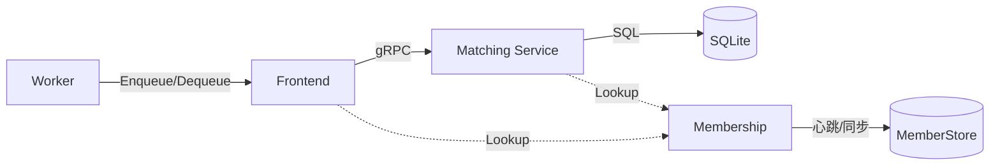
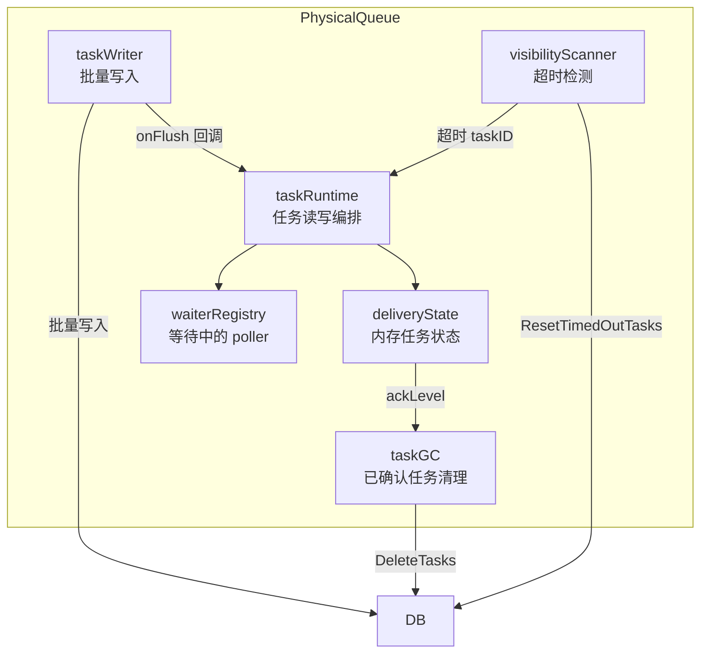
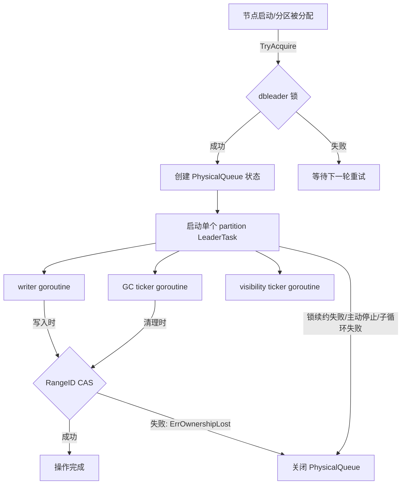
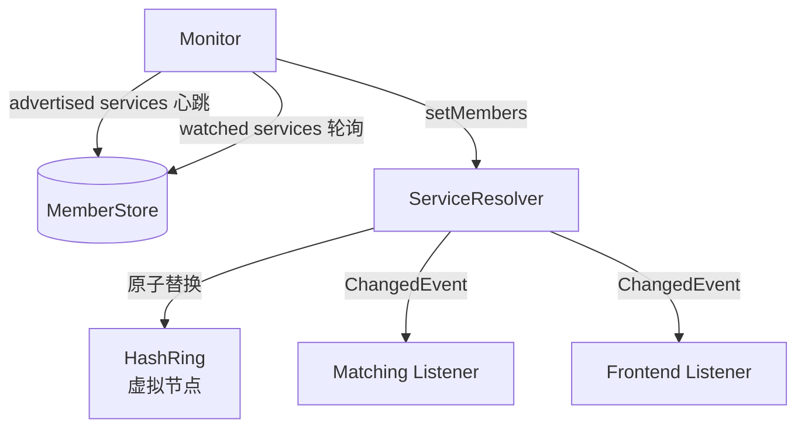
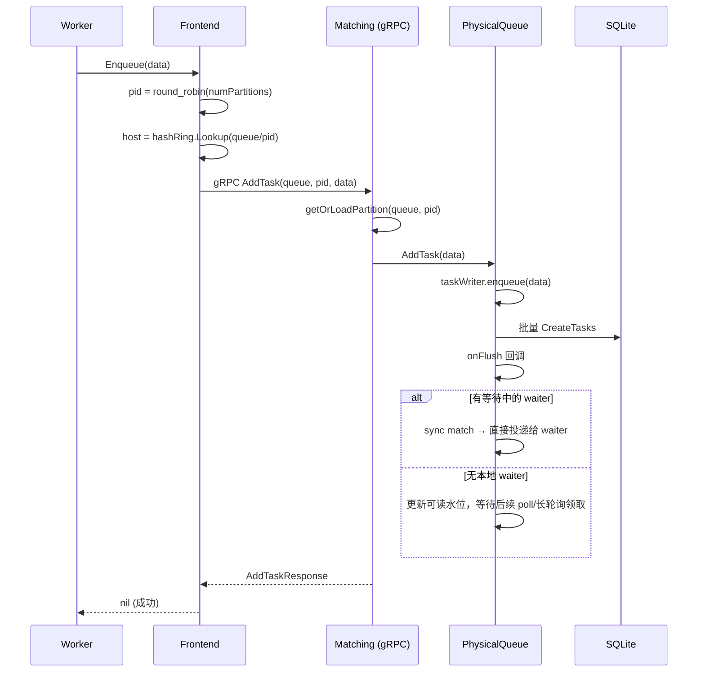
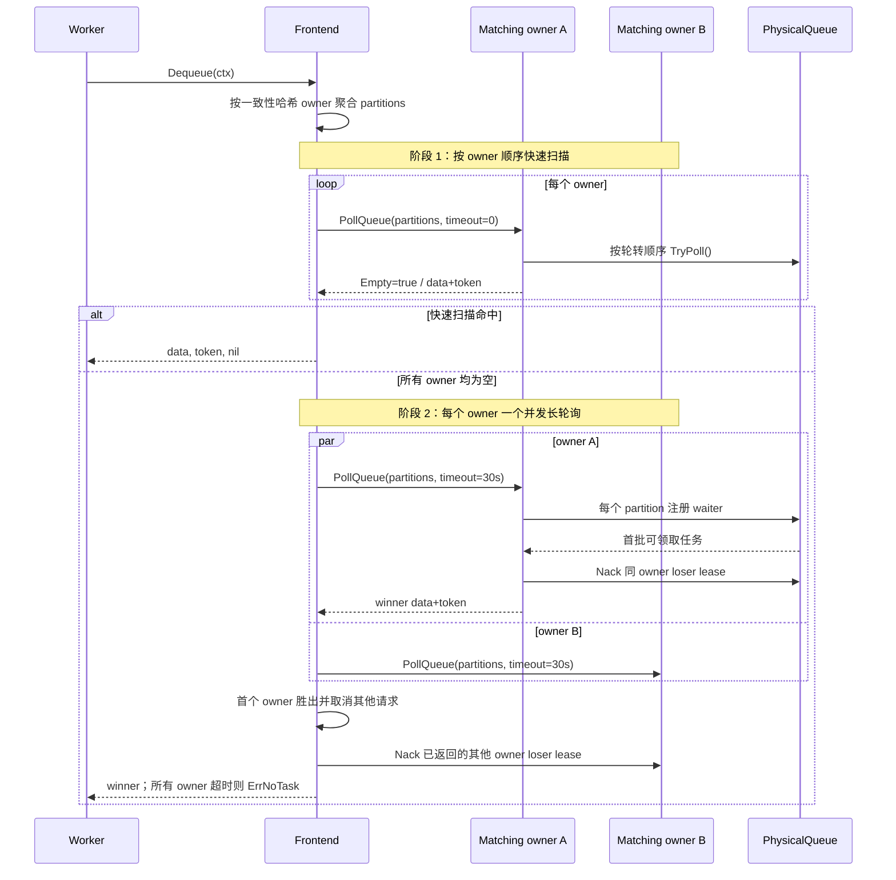
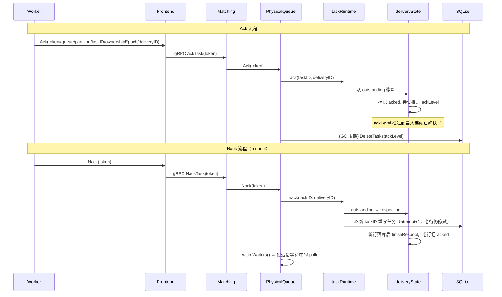
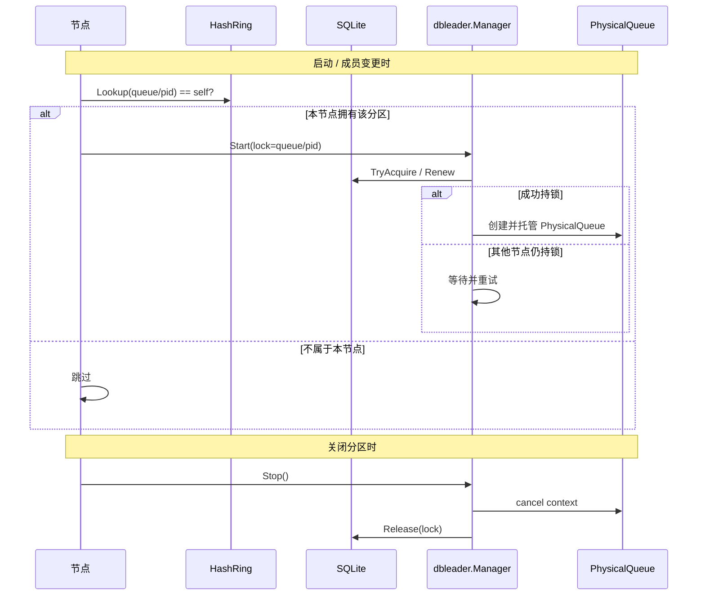
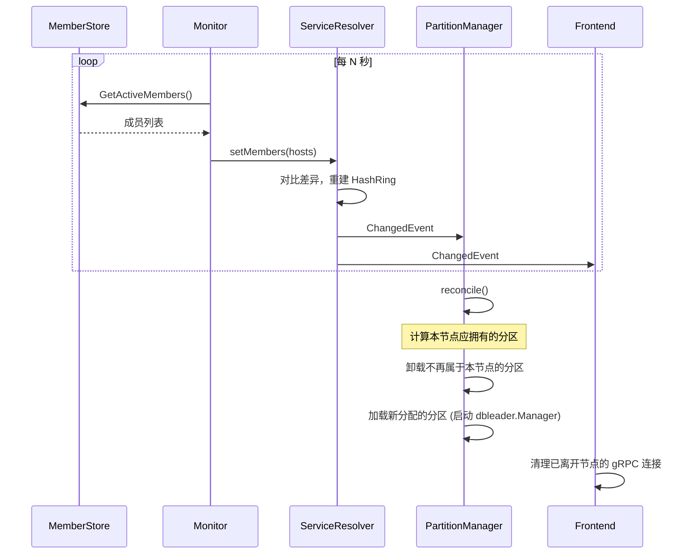

# TaskQ — 分布式任务队列

TaskQ 是一个 Temporal 风格的分布式任务队列系统，使用 Go 实现。支持多分区、at-least-once 投递语义、一致性哈希路由、`dbleader` 分区独占、长轮询消费和可见性超时自动重投递。

## 核心特性

- **多分区队列** — 水平扩展吞吐量，round-robin 分发写入
- **At-least-once 投递** — 可见性超时 + 自动重投递（respool 换新 taskID），失败任务不丢，且不冻结 `ackLevel`
- **一致性哈希路由** — 基于虚拟节点的哈希环，分区自动分配到集群节点
- **`dbleader` 锁 + RangeID CAS** — 运行期开关由 `dbleader` 控制，写入围栏继续由 `rangeID` CAS 兜底
- **长轮询消费** — 无任务时 worker 阻塞等待，任务到达即时唤醒
- **Sync Match** — 写入时直接匹配等待中的消费者，零延迟投递
- **定向投递与原行 fallback** — RoutingKey 在 deadline 前定向到指定 worker，过期后由同一 TaskID 参与普通消费

## 系统架构

```
┌──────────┐     ┌──────────────┐     gRPC      ┌─────────────────┐     SQL     ┌────────┐
│  Worker  │────▶│   Frontend   │──────────────▶│    Matching      │───────────▶│   DB   │
│  (消费者) │◀────│  (路由层/库)  │◀──────────────│  (分区管理/gRPC) │◀───────────│(SQLite)│
└──────────┘     └──────────────┘               └─────────────────┘            └────────┘
                        │                              │
                        │        ┌──────────────┐      │
                        └───────▶│  Membership  │◀─────┘
                                 │ (成员发现/哈希环)│
                                 └──────────────┘
```



### 四层架构

| 层 | 包 | 职责 |
|---|---|---|
| **Worker** | 用户代码 | 调用 Frontend API 生产/消费任务 |
| **Frontend** | `frontend` | 客户端路由库，一致性哈希定位分区所属节点，gRPC 连接池 |
| **Matching** | `matching` | gRPC 服务，管理分区所有权，处理 AddTask/PollTask/Ack/Nack |
| **Queue** | `queue` | 核心存储引擎，PhysicalQueue 管理单分区的完整生命周期 |
| **Membership** | `membership` | 节点发现，一致性哈希环，成员变更通知 |

## 核心组件

### Queue 包

#### Store 接口

`Store` 是可插拔的持久化抽象层。公共实现位于 `store/gormstore`，基于 GORM 支持 SQLite 和 MySQL。

```go
type Store interface {
    // 队列元数据
    CreateQueue(ctx, info) error
    GetQueue(ctx, queueName, partitionID) (*QueueInfo, error)
    AllocateTaskIDRange(ctx, queueName, partitionID, newNextTaskID, prevRangeID) (int64, error)
    AdvanceAckLevelAndDeleteTasks(ctx, queueName, partitionID, newAckLevel, prevRangeID) (int64, int64, error)

    // 任务 CRUD
    CreateTasks(ctx, tasks) error
    GetTasks(ctx, queueName, partitionID, min, max, limit) ([]*TaskRow, error)
    GetTasksWithOptions(ctx, queueName, partitionID, min, max, limit, opts) ([]*TaskRow, error)
    DispatchTask(ctx, queueName, partitionID, taskID, dispatchedAt) error
    UnDispatchTask(ctx, queueName, partitionID, taskID) error
    ResetTimedOutTasks(ctx, queueName, partitionID, opts VisibilityResetOptions) ([]int64, error)
    Close() error
}
```

`matching.Config.Store` 使用显式的 `matching.Store` 契约，组合 `queue.Store` 与 `dbleader.LockStore`。`store/gormstore.Store` 覆盖 queue 元数据、任务表、分区锁表和锁成员表。连接生命周期由调用者管理；`Matching.Stop` 只停止服务自身。`Store.Membership()` 返回共享同一 GORM 连接的 `membership.MemberStore` 适配器，连接由父 `Store.Close()` 统一释放。

**数据库表结构：**

| 表 | 关键列 | 用途 |
|---|---|---|
| `queue_info` | queue_name, partition_id, range_id, ack_level, next_task_id | 分区元数据 |
| `tasks` | task_id, queue_name, partition_id, routing_key, routing_deadline, data, created_at, dispatched_at | 任务数据与定向 fallback |
| `taskq_partition_lock` | lock_name, leader_ip, expire_at_ms, version | `dbleader` 分区锁 |
| `taskq_partition_lock_members` | lock_name, instance_id, node_ip, last_seen | `dbleader` 成员心跳 |
| `taskq_membership_members` | service_name, rpc_address, rpc_port, heartbeat_at, expires_at | `membership.Monitor` 服务发现心跳 |

#### PhysicalQueue — 单分区核心

每个 `PhysicalQueue` 管理一个分区的内存状态和对外服务逻辑。它本身不再在构造时自动启动后台循环；writer、GC、可见性扫描都由外层单独运行。

当前生产路径为每个分区创建一个 `dbleader` LeaderTask。LeaderTask 获得锁后创建 `PhysicalQueue`，等待 writer 就绪，再并行运行 writer、GC ticker 和 visibility ticker；任一循环返回错误会取消另外两个循环并关闭该分区。



| 组件 | 职责 | 周期 |
|---|---|---|
| **taskWriter** | 收集入队请求，批量 flush 到 DB，触发 sync match | LeaderTask 持锁期间持续运行 |
| **taskRuntime** | 负责取任务、dispatch、ack/nack，把存储操作和内存状态衔接起来 | - |
| **deliveryState** | 内存中维护 outstanding/redelivery/acked 集合，追踪 ackLevel/maxReadLevel | - |
| **waiterRegistry** | 管理长轮询阶段注册的等待者 | - |
| **taskGC** | 根据 ackLevel 删除已确认的任务，通过 CAS 持久化 ackLevel | LeaderTask 内每 5s 执行一次 |
| **visibilityScanner** | 检测超时的已分发任务，移入 redelivery 队列 | LeaderTask 内每 1s 执行一次 |
多分区分配不在 `queue` 包内完成。真实链路是：

- `membership` 负责一致性哈希，把 `queue/partition` 映射到节点
- `matching` 负责按需加载对应分区，并通过 `dbleader.Manager` 持锁运行、失锁停止
- `PhysicalQueue` 只负责自己这一个分区的任务生命周期与长轮询

#### 运行期开关与写入围栏



| 层 | 机制 | 时机 | 作用 |
|---|---|---|---|
| **运行期开关** | `dbleader` 锁 | 分区状态创建、writer/GC/扫描器运行、停止 | 保证同一时刻只有一个节点真正对外服务 |
| **RangeID CAS** | 乐观锁：`UPDATE WHERE range_id = prevRangeID` | 每次写入/GC | 检测写冲突，防止脑裂写入 |

### Membership 包

节点发现和一致性哈希路由层。



| 组件 | 职责 |
|---|---|
| **Monitor** | 为 advertised services 写心跳，为 watched services 维护 ServiceResolver |
| **ServiceResolver** | 维护哈希环，提供 `Lookup(key)` 路由查询，广播成员变更事件 |
| **HashRing** | 虚拟节点（默认 100 个/节点），farm.Fingerprint32 哈希，顺时针查找 |
| **HostInfo** | 节点元数据：地址、draining 状态、定时加入/退出 |

### Matching 包

gRPC 分区管理服务，每个节点只处理哈希环分配给自己的分区。

**gRPC 接口（`matching.proto`）：**

| RPC | 功能 |
|---|---|
| `AddTask` | 写入任务到指定分区 |
| `PollTask` | 消费任务（支持非阻塞和长轮询） |
| `PollQueue` | 一次轮询同一 owner 的多个分区，返回一个任务并回收同时命中的其他 lease |
| `AckTask` | 确认消费完成 |
| `NackTask` | 拒绝消费，触发重投递（respool）；`undelivered=true` 表示仅归还未交付的 lease，不计入 attempt |
| `GetQueueInfo` | 查询队列的分区数 |

**PartitionManager** 核心逻辑：

- `isOwner(queue, pid)` — 通过哈希环判断本节点是否拥有该分区
- `getOrLoadPartition` — 延迟加载，首次请求时启动 `dbleader.Manager`，等分区真正可服务后再返回
- `reconcile()` — 成员变更时重新计算分区分配，加载新分区、卸载失去的分区

### Frontend 包

客户端路由 SDK（**不是独立服务、不监听端口**），直接链接进 worker 进程，worker 通过它透明访问分布式队列。

- 通过 `GetQueueInfo` 自动发现分区数量
- round-robin 选分区写入
- 快速扫描 + 长轮询消费
- gRPC 连接池，成员离开时自动清理
- 失败重试（`FailedPrecondition` / `Unavailable`）

## 关键工作流程

### Enqueue 流程



### At-least-once 与业务幂等契约

`Frontend.Enqueue` 对可重试的 AddTask 路由或 gRPC 错误最多尝试 3 次，重试间隔为 50ms。Matching 可能已经提交任务，而 AddTask 响应在网络中丢失；后续重试会写入另一条任务。消费者进程退出、visibility timeout 和 Nack 也会触发重新投递。

生产接入遵循以下约定：

1. 生产者在 payload 中携带稳定的业务幂等键，例如 `order_id + operation`，应用层重试继续使用同一个键。
2. 消费者在业务数据库事务内写入幂等键唯一记录并执行副作用；唯一键冲突表示该任务已经处理。
3. 业务事务提交成功后调用 `Ack`。处理失败时返回错误或调用 `Nack`，让任务重新投递。
4. 外部系统调用使用同一个幂等键作为对方接口的 idempotency key，覆盖“外部调用成功、消费者提交前退出”的窗口。

```sql
CREATE UNIQUE INDEX uk_task_effect_idempotency_key
ON task_effects (idempotency_key);
```

TaskQ 提供 at-least-once delivery；业务幂等键定义一次业务效果。

### 投递重试、respool 与 attempt 上限

失败任务（`Nack`、可见性超时）不再原地放回，而是 **respool**：以更高的 `taskID` 重写一条新任务，再确认（ack）老行。这样单条反复失败的任务不会永久钉死 `ackLevel`——`acked` 内存与 `tasks` 表持续 GC，队列始终能向前推进。该机制对齐 Temporal matching 层的 `respoolTaskAfterError`。

- **`attempt` 列** — `tasks` 表新增，记录该任务已失败的投递次数（首次写入为 0）。持久化在行上，进程重启 / 分区易主后计数不丢。
- **`MaxAttempts`（`matching.Config`）** — 单任务的总投递次数上限。**默认 `0` 表示不限次数**：反复失败的任务持续 respool，`ackLevel` 不会被其阻塞，数据也不会被 TaskQ 主动删除。设为正数才启用上限，超过后任务被丢弃并仅记录一条 `error` 日志。
- **毒丸处理** — 遇到无法处理的消息，推荐消费者**自行持久化后回 `Ack`**（而非 `Nack`），让任务正常出队。TaskQ 是运输层，不替业务决定丢弃数据，因此默认不设上限。

> **行为变化（自 respool 版本起）**
> - `Nack` 返回后任务**不再立即可 poll**：新行由 writer 异步落库，需等下一轮 flush。
> - 同分区消费顺序进一步弱化：respool 把重试任务排到队尾（新 `taskID`）。TaskQ 本就不保证跨分区顺序，同分区顺序也因重试被打乱。
> - 老 attempt 的 token 在其 delivery 退役后，`Ack`/`Nack` 返回从 `ErrStaleToken` 变为 `ErrTaskNotOutstanding`（老 `taskID` 已退役，无从判定 stale）。

### Dequeue 流程



Frontend 兼容仅实现旧契约的 Matching 节点：`PollQueue` 返回 `Unimplemented` 时，同一 owner 内回退为并发 `PollTask`。Matching 和 Frontend 都使用独立的一秒清理上下文回收 loser lease；调用方取消与 delivery 同时发生时，Matching 先 Nack 已领取的 lease，再返回 `Canceled`。

`PollQueue` 将一次 Dequeue 的 RPC fan-out 从分区数量 `O(partitions)` 收敛为 Matching owner 数量 `O(owners)`；快速阶段顺序扫描 owner，长轮询阶段并发等待 owner。

### Ack / Nack 流程



> Nack 返回后任务**不再立即可 poll**：新行由 writer 异步落库，需等下一轮批量 flush 才可读。内部归还未交付的 lease（多分区 poll 竞速的败者、调用方取消）走 `ReturnLease` / `undelivered=true`，原地退回、**不消耗 attempt**。

### 分区所有权流程



### 成员变更 → Reconcile



### 运行时调整分区数

分区数是纯 dynamic 的（DB `partition_config` 表：`_default_` 全局默认行 + per-queue override 行），
运行时可增可减。**唯一安全的调整入口是 `matching.Server.ResizePartitions`**：

```go
// 把 my-queue 的分区数调整为 8（扩容）或 2（缩容），期间不丢任务。
if err := matchingServer.ResizePartitions(ctx, "my-queue", 8); err != nil {
    log.Fatal(err)
}
```

分区数分裂为 `num_read` / `num_write` 两个值，不变式 `1 <= write <= read`：
写只落在 `[0, write)`，读枚举 `[0, read)`，因此被写的分区一定在被读的集合内。

**扩容（target > 当前 read）——先 read 后 write：**

1. `Set(read=target, write=旧值)`：新分区先被 matching own 并可被 poll，此时还没人往里写
2. 等待 > `partitionConfigTTL`（5s），让各 matching 节点与 frontend 感知新 read
3. `Set(read=target, write=target)`：写开始命中新分区

**缩容（target < 当前 read）——四步严格有序、不可压缩：**

1. `Set(read=旧值, write=target)`：**只减 write**。matching 立刻按新 `numWrite` 硬拒
   `partID >= target` 的 `AddTask`（`FailedPrecondition`），frontend 收到后刷新快照重选分区
2. **写收敛静默期**：等待 > `partitionConfigTTL`，让缓存滞后的 frontend 过期、在途 `AddTask` 落定
3. **drain 轮询**：对每个高位分区 `[target, 旧 read)` 检查 `ack_level == next_task_id - 1`，
   且该状态必须**连续稳定持续 > `partitionGCInterval`（5s）**
4. `Set(read=target, write=target)`：确认全部排空后才减 read

**为什么缩容必须走 orchestrator，不能直接 `SetPartitions` 减 read：**
「停止写高位分区」是**跨节点最终一致**的——它靠各节点配置缓存的 TTL 过期来传播；
而「减 read」是**一步到位**的。如果在还可能有滞后节点往高位分区写入时就减小 read，
该分区立刻失去 owner：没有节点 own 它 → 没人 poll、GC 也停摆 → 其中的任务**永不被消费、
静默丢失**。静默期 + drain 确认就是把这个最终一致的过程收敛为全局事实之后再动 read。
同理，`SetDefaultPartitions`（全局默认行）**硬 guard 只允许 grow**：缩小全局默认等于对所有
无 override 的 queue 做了一次无 drain 的隐式缩容。确需缩全局默认时，先给每个目标 queue
显式 `SetPartitions` 钉住旧值，逐个 `ResizePartitions` 缩容后再调默认。

**drain 超时的含义：**
`ResizePartitions` 的 drain 轮询有总超时（默认 2 分钟），超时返回包装 `ErrPartitionDrainTimeout`
的错误，并上报**卡住的分区号、`ack_level`/`next_task_id`、最早未确认的 `task_id`**。
最常见的原因是高位分区里有反复失败的 poison 任务：`MaxAttempts=0`（默认）不限投递次数，
这类任务会持续 respool，把 `ackLevel` 永久钉住。处理方式是先定位并处理该任务
（消费者自行持久化后回 Ack，或设置 `MaxAttempts` 上限），再重试缩容。

超时/取消/DB 错误时缩容停在 `(read=旧值, write=target)`——这是**安全中间态**：
高位分区停写但仍被 own、仍可 poll/ack、GC 仍在跑，数据不会孤立，修复后直接重试即可。

**迟到 Ack/Nack：** 缩容完成后，指向已退役分区的 Ack/Nack 重试返回**幂等成功**而非
`InvalidArgument`。理由是能推进到「减 read」这一步就意味着该分区已被确认完全排空，
此类请求必然是重复的。

## PhysicalQueue 内部结构

### deliveryState 状态

```
内存状态：
┌─────────────────────────────────────────────────────┐
│ ackLevel: 已确认的最高连续 taskID                       │
│ readLevel: 已从 DB 读取的最高 taskID                    │
│ maxReadLevel: DB 中已知的最高 taskID                    │
│                                                     │
│ outstanding: {taskID → 已分发但未确认的任务}              │
│ respooling:  {taskID → 正以新 taskID 重写、等待落库}      │
│ redelivery:  [waiter 消失等待原地重投递的任务]             │
│ acked:       {taskID → true, 已确认但 ackLevel 尚未推进} │
└─────────────────────────────────────────────────────┘

任务状态流转：
  DB → tryGetTask() → outstanding ─ ack() ─────────→ acked → advanceAckLevel → GC 删除
                                 ├ nack()/超时 → respooling → (新行落库) finishRespool → acked
                                 └ waiter 消失 → redelivery → tryGetTask() → outstanding → ...

  respooling 的老行在新行落库后记为 acked（相当于就地退役）；新行以 attempt+1 排到队尾重新参与消费。

ackLevel 推进规则 (advanceAckLevel)：
  从 ackLevel+1 开始逐个检查：
  - 在 outstanding 中 → 停止（还在处理中）
  - 在 respooling 中 → 停止（新行未落库，绝不提前 ack 老行）
  - 在 redelivery 中 → 停止（未重新确认，防止 GC 删除）
  - 在 acked 中 → 推进，继续检查下一个
  - 其他 → 停止（还没读到）
```

`deliveryState` 只维护内存中的任务状态；真正和 DB 打交道的是 `taskRuntime`。这样状态规则和存储调用分开，`PhysicalQueue` 自己只需要装配这些组件。

### Sync Match 与 waiterRegistry

```
任务写入 → taskWriter flush → onFlush 回调：

  ┌─────────────────────────────┐
  │ 遍历 flush 的每个 row：      │
  │  1. setMaxReadLevel(taskID)  │
  │  2. taskRuntime 尝试投递      │
  │  3. waiterRegistry 有等待者？ │
  │     ├─ 是 → 取出 waiter       │
  │     │     → dispatch 任务     │
  │     │     → 发送到 channel    │
  │     └─ 否 → 保留在本分区       │
  └─────────────────────────────┘
  
  后续 `TryPoll` / `RegisterWaiter` 仍然只消费本分区中的可读任务。
```

## 配置参考

### Queue 内部常量

| 内部常量 | 值 | 说明 |
|---|---|---|
| Partition lease TTL | 3s | `matching` 分区锁过期时间 |
| Partition lease renew | 1s | `matching` 分区锁续期间隔 |
| Partition lease retry | 200ms | 抢锁与续约故障重试间隔 |
| GC Interval | 5s | 已确认任务清理间隔 |
| Vis Scan Interval | 1s | 超时任务检测间隔 |
| Writer Buffer | 256 | 写入 channel 大小 |
| Matching Reconcile | 5s | 成员事件之外的分区归属周期校验 |

### Membership

```go
monitor := membership.NewMonitorWithConfig(membership.MonitorConfig{
    AdvertisedServices: []string{"matching"},
    WatchedServices:    []string{"matching"},
    Store:              memberStore,
    BroadcastAddr:      netip.MustParseAddrPort("10.0.0.1:7235"),
    PollInterval:       3*time.Second,
    PropagationTime:    5*time.Second,
    ReplicaPoints:      100,
})
```

`AdvertisedServices` 决定本进程写入哪些服务心跳；`WatchedServices` 决定本进程维护哪些服务的 resolver。Matching 进程通常同时 advertise 和 watch `matching`。旧 `NewMonitor(serviceNames, ...)` 保持兼容，它会把 `serviceNames` 同时映射到两个集合。

### Matching

```go
matching.Config{
    Store:         store,                           // 必填
    Monitor:       monitor,                         // 必填
    ServiceName:   "matching",                      // 默认 "matching"
    ListenAddr:    ":7235",                         // gRPC 监听地址
    BroadcastAddr: "10.0.0.1:7235",                 // 必填，广播地址
    VisTimeout:    60 * time.Second,                // 默认 60s
    MaxAttempts:   0,                               // 单任务投递次数上限，0=不限（默认）
    DefaultPartitions: 4,                           // 仅 bootstrap 全局默认行，已存在则不覆盖
    LeaseOwner:    "",                              // 为空时自动生成 UUID
    ReconcileInterval: 5 * time.Second,             // 默认 5s
    GRPCOptions:   []grpc.ServerOption{},           // 可选
}
```

### Frontend

```go
frontend.Config{
    ResolverProvider: monitor,                     // 推荐：只依赖 resolver provider
    ServiceName:      "matching",                  // 默认 "matching"
    QueueName:        "my-queue",                  // 必填
    DialOpts:         []grpc.DialOption{...},       // gRPC 拨号选项
    PollTimeout:      30 * time.Second,             // 长轮询超时，默认 30s
}
```

`Monitor` 字段继续兼容已有调用；新装配使用 `ResolverProvider`，Frontend 只依赖 `GetResolver`。

## 快速开始

```go
package main

import (
    "context"
    "fmt"
    "log"
    "net"
    "net/netip"
    "time"

    "github.com/donutnomad/taskq/frontend"
    "github.com/donutnomad/taskq/matching"
    "github.com/donutnomad/taskq/membership"
    "github.com/donutnomad/taskq/store/gormstore"
    "google.golang.org/grpc"
    "google.golang.org/grpc/credentials/insecure"
)

func main() {
    ctx := context.Background()

    // 1. 创建存储
    store, _ := gormstore.NewSQLite("taskq.db", gormstore.Config{AutoMigrate: true})
    defer store.Close()

    // 2. Membership 适配器与 queue/leader store 共享连接
    memberStore := store.Membership()

    // 3. 启动成员发现
    lis, _ := net.Listen("tcp", "127.0.0.1:0")
    addr := lis.Addr().String()
    addrPort, _ := netip.ParseAddrPort(addr)
    lis.Close()

    monitor := membership.NewMonitorWithConfig(membership.MonitorConfig{
        AdvertisedServices: []string{"matching"},
        WatchedServices:    []string{"matching"},
        Store:              memberStore,
        BroadcastAddr:      addrPort,
        PollInterval:       time.Second,
        PropagationTime:    time.Second,
        ReplicaPoints:      100,
    })
    monitor.Start()
    monitor.WaitUntilInitialized(ctx)
    defer monitor.Stop()

    // 4. 启动 Matching 服务
    srv, _ := matching.NewServer(matching.Config{
        Store:         store,
        Monitor:       monitor,
        ListenAddr:    addr,
        BroadcastAddr: addr,
        QueueConfigs:  map[string]int{"demo-queue": 4},
    })
    srv.Start()
    defer srv.Stop()

    // 5. 创建 Frontend
    fe, _ := frontend.New(frontend.Config{
        ResolverProvider: monitor,
        QueueName:        "demo-queue",
        DialOpts:         []grpc.DialOption{grpc.WithTransportCredentials(insecure.NewCredentials())},
        PollTimeout:      5 * time.Second,
    })
    defer fe.Close()

    // 6. 生产
    fe.Enqueue(ctx, []byte(`{"type":"send-email","to":"user@example.com"}`))

    // 7. 消费
    data, token, err := fe.Dequeue(ctx)
    if err != nil {
        log.Fatal(err)
    }
    fmt.Printf("收到任务: %s\n", data)

    // 8. 确认（或 Nack 重投递）
    fe.Ack(ctx, token)
    // fe.Nack(ctx, token) // 拒绝，任务会被重新投递
}
```

可直接运行仓库里的完整示例：

```bash
go run ./internal/example/
```

### 生产装配

生产环境先通过发布系统迁移 `queue_info`、`tasks`、`partition_config`、`taskq_partition_lock`、`taskq_partition_lock_members` 和 `taskq_membership_members` 六张表，再以 `AutoMigrate: false` 启动进程：

从 routed delivery 之前的版本升级时，MySQL 使用以下兼容迁移：

```sql
ALTER TABLE tasks
	ADD COLUMN routing_key VARCHAR(191) NOT NULL DEFAULT '',
    ADD COLUMN routing_deadline DATETIME(6) NULL;

CREATE INDEX idx_tasks_visibility
    ON tasks (queue_name, partition_id, dispatched_at, routing_key, task_id);

CREATE INDEX idx_tasks_routing_deadline
    ON tasks (queue_name, partition_id, dispatched_at, routing_deadline, task_id);
```

SQLite 使用以下兼容迁移：

```sql
ALTER TABLE tasks ADD COLUMN routing_key TEXT NOT NULL DEFAULT '';
ALTER TABLE tasks ADD COLUMN routing_deadline DATETIME NULL;

CREATE INDEX idx_tasks_visibility
    ON tasks (queue_name, partition_id, dispatched_at, routing_key, task_id);

CREATE INDEX idx_tasks_routing_deadline
    ON tasks (queue_name, partition_id, dispatched_at, routing_deadline, task_id);
```

从记录重试次数之前的版本升级时，MySQL 使用以下兼容迁移：

```sql
ALTER TABLE tasks ADD COLUMN attempt INT NOT NULL DEFAULT 0;
```

SQLite 使用以下兼容迁移：

```sql
ALTER TABLE tasks ADD COLUMN attempt INTEGER NOT NULL DEFAULT 0;
```

自动分区（`partition_config`）配置表按 `scope` 主键存全局默认行与 per-queue override 行，`_default_` 为保留 scope，初始 `num_read=num_write=4`。MySQL 建表与初始化：

```sql
CREATE TABLE partition_config (
    scope      VARCHAR(191) NOT NULL,
    num_read   INT NOT NULL,
    num_write  INT NOT NULL,
    updated_at DATETIME(6) NOT NULL,
    PRIMARY KEY (scope)
);

INSERT INTO partition_config (scope, num_read, num_write, updated_at)
VALUES ('_default_', 4, 4, NOW(6))
ON DUPLICATE KEY UPDATE scope = scope;
```

SQLite 建表与初始化：

```sql
CREATE TABLE partition_config (
    scope      TEXT NOT NULL PRIMARY KEY,
    num_read   INTEGER NOT NULL,
    num_write  INTEGER NOT NULL,
    updated_at DATETIME NOT NULL
);

INSERT OR IGNORE INTO partition_config (scope, num_read, num_write, updated_at)
VALUES ('_default_', 4, 4, CURRENT_TIMESTAMP);
```

已经部署 Slice D routing key 的环境保留现有 `routing_key` 与 `idx_tasks_visibility`，只执行 deadline 列和 deadline 索引语句。上线顺序为先创建列与索引，再部署读写 routing 字段的 TaskQ 二进制。零值 deadline 持久化为 `NULL`，表示永久按 routing key 定向；非空 deadline 到期后由原任务行直接参与普通 poll，原任务行、TaskID 和 AckLevel 保持连续。每次 delivery 生成新的 token；旧 attempt token 无法 Ack 或 Nack 后续 delivery。

```go
store, err := gormstore.NewMySQL(os.Getenv("TASKQ_MYSQL_DSN"), gormstore.Config{
    AutoMigrate: false,
})
if err != nil {
    return err
}

monitor := membership.NewMonitorWithConfig(membership.MonitorConfig{
    AdvertisedServices: []string{"matching"},
    WatchedServices:    []string{"matching"},
    Store:              store.Membership(),
    BroadcastAddr:      netip.MustParseAddrPort(broadcastAddr),
    PollInterval:       3*time.Second,
    PropagationTime:    5*time.Second,
    ReplicaPoints:      200,
})
monitor.Start()
initCtx, cancelInit := context.WithTimeout(ctx, 30*time.Second)
defer cancelInit()
if err := monitor.WaitUntilInitialized(initCtx); err != nil {
    monitor.Stop()
    _ = store.Close()
    return err
}

server, err := matching.NewServer(matching.Config{
    Store:             store,
    Monitor:           monitor,
    ListenAddr:        listenAddr,
    BroadcastAddr:     broadcastAddr,
    QueueConfigs:      queueConfigs,
    ReconcileInterval: 5 * time.Second,
})
if err != nil {
    monitor.Stop()
    _ = store.Close()
    return err
}
if err := server.Start(); err != nil {
    monitor.Stop()
    _ = store.Close()
    return err
}

<-ctx.Done()

// Shutdown 顺序：停止流量与分区，再停止成员心跳，最后关闭共享 DB。
server.Stop()
monitor.Stop()
return store.Close()
```

每个进程创建一个父 `gormstore.Store`，Matching 与 Membership 共用该连接池。应用负责在 `Store.Close()` 前停止所有 Server、Monitor 和 Frontend 实例。`AutoMigrate: true` 适用于本地开发和测试。

独立 Worker 使用 observer-only Monitor。该进程读取 Matching 成员记录并维护 resolver，成员表只保留真实 Matching 节点：

```go
observer := membership.NewMonitorWithConfig(membership.MonitorConfig{
    WatchedServices: []string{"matching"},
    Store:           store.Membership(),
    PollInterval:    3*time.Second,
    PropagationTime: 5*time.Second,
    ReplicaPoints:   200,
})
observer.Start()
if err := observer.WaitUntilInitialized(ctx); err != nil {
    return err
}
defer observer.Stop()

workflowTasks, err := frontend.New(frontend.Config{
    ResolverProvider: observer,
    QueueName:        "workflow-tasks",
    PollTimeout:      30*time.Second,
})
```

## 项目结构

```
taskq/
├── queue/                      # 核心存储引擎
│   ├── store.go                # Store 接口定义
│   ├── session_claim.go        # PhysicalQueue 会话 claim
│   ├── physical_queue.go       # 单分区队列总控
│   ├── writer.go               # 批量写入器
│   ├── task_runtime.go         # 任务获取 / ack / nack 编排
│   ├── delivery_state.go       # 内存任务状态
│   ├── waiter_registry.go      # 长轮询等待者管理
│   ├── token.go                # token 生成与校验
│   ├── gc.go                   # 已确认任务垃圾回收
│   ├── visibility.go           # 可见性超时扫描器
│   ├── ownership.go            # rangeID CAS 所有权
│   ├── *_test.go               # 测试
│   └── lease_test.go           # 兼容保留的 lease 存储测试
├── membership/                 # 成员发现 + 一致性哈希
│   ├── membership.go           # 接口定义
│   ├── monitor.go              # 心跳 + 成员同步
│   ├── service_resolver.go     # 哈希环路由 + 事件通知
│   ├── hashring.go             # 一致性哈希环
│   ├── hostinfo.go             # 节点元数据
│   ├── *_test.go               # 测试
│   └── example/                # 使用示例
├── matching/                   # gRPC 分区管理服务
│   ├── matching.proto          # Protobuf 定义
│   ├── matching.go             # Server 生命周期
│   ├── server.go               # gRPC Handler
│   ├── partition_mgr.go        # 分区管理 + Reconcile
│   ├── matching.pb.go          # 生成代码
│   ├── matching_grpc.pb.go     # 生成代码
│   └── matching_test.go        # 集成测试
├── frontend/                   # 客户端路由库
│   ├── frontend.go             # 路由器（Enqueue/Dequeue/Ack/Nack）
│   ├── client.go               # gRPC 连接池
│   └── frontend_test.go        # 端到端测试
├── store/gormstore/            # GORM 持久化实现
│   ├── store.go                # SQLite/MySQL queue.Store + dbleader.LockStore
│   ├── membership.go           # membership.MemberStore 独立表适配器
│   ├── store_test.go           # SQLite 契约测试
│   └── mysql_integration_test.go # MySQL Docker 集成测试
├── internal/example/
│   └── main.go                 # 完整使用示例
├── go.mod
└── go.sum
```

## 依赖

| 依赖 | 用途 |
|---|---|
| `github.com/dgryski/go-farm` | FarmHash — 一致性哈希环的哈希函数 |
| `github.com/google/uuid` | UUID 生成 — 节点标识和 Lease Owner |
| `google.golang.org/grpc` | gRPC 框架 — Matching 服务通信 |
| `google.golang.org/protobuf` | Protobuf 序列化 |
| `gorm.io/gorm` | GORM 持久化框架 |
| `github.com/glebarez/sqlite` | 纯 Go SQLite GORM 驱动 |
| `gorm.io/driver/mysql` | MySQL GORM 驱动 |
| `testcontainers-go` | MySQL 集成测试容器 |

## 运行测试

```bash
# 全量测试
go test ./... -v

# MySQL 集成测试
go test -tags=integration ./store/gormstore -v

# 主要包做 race 检测
go test ./membership ./queue ./matching ./frontend -v -race

# 运行示例
go run ./internal/example/
```
